# yaml2cv architecture

This document describes the architecture of yaml2cv as it is today. It
follows the [arc42](https://arc42.org) template; structural diagrams use the
[C4 model](https://c4model.com) notation, drawn with Mermaid (ADR 0047).

The reasoning behind each design choice lives in the
[architecture decision records](adr/). This document links them where they
shape a part, but does not repeat their history. When code and document
disagree, the code is right and the document needs a fix.

## Contents

1. [Introduction and goals](#1-introduction-and-goals)
2. [Constraints](#2-constraints)
3. [Context and scope](#3-context-and-scope)
4. [Solution strategy](#4-solution-strategy)
5. [Building block view](#5-building-block-view)
6. [Runtime view](#6-runtime-view)
7. [Deployment view](#7-deployment-view)
8. [Crosscutting concepts](#8-crosscutting-concepts)
9. [Architecture decisions](#9-architecture-decisions)
10. [Quality requirements](#10-quality-requirements)
11. [Risks and technical debt](#11-risks-and-technical-debt)
12. [Glossary](#12-glossary)

Diagram legend, used in every structural view:

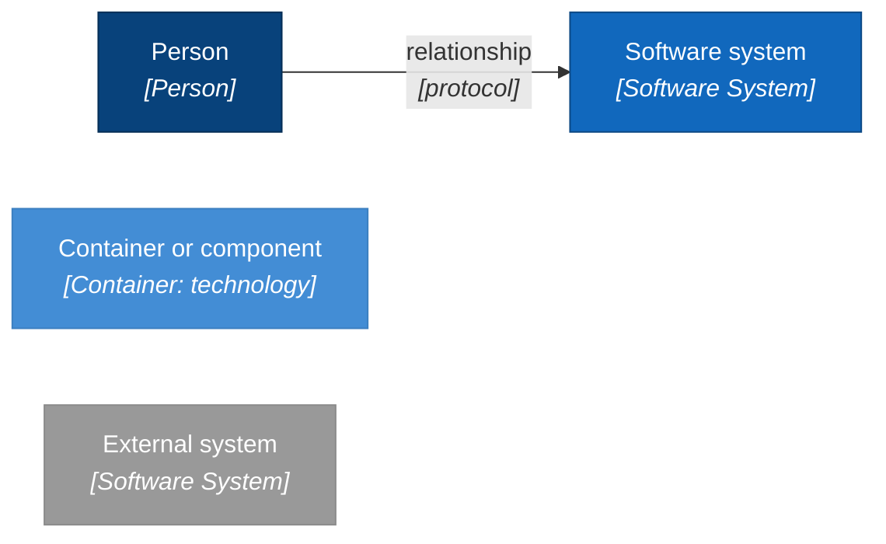

---

## 1. Introduction and goals

yaml2cv renders a CV (curriculum vitae) written in a small YAML schema to a
typeset PDF. People keep their CV as one structured, self-contained text
file, under version control if they like, and get a consistent, well set
document back, in one of five themes.

The service is a stateless web application. It offers:

- an **HTTP API** that validates a CV or renders it to PDF, for scripts and
  other programs;
- a **browser editor** with live validation, a live page preview, schema
  completion, a visual block editor as an alternative to raw YAML, English
  and German UI, and PDF download;
- an **admin listener** and an optional **UDP heartbeat** so operators can
  discover instances and see their state.

### 1.1 Requirements overview

| ID | Requirement |
| --- | --- |
| F1 | Validate a CV against schema version 1 and report every error with its path (`sections[1].entries[0].title`) or its line and column. |
| F2 | Render a valid CV to PDF in the theme, colour, paper size and photo shape it names. |
| F3 | Edit a CV in the browser as YAML or as visual blocks, see validation and preview while typing, download the PDF. |
| F4 | Keep a profile photo inside the CV document. |
| F5 | Run as a container image; configure everything through environment variables. |
| F6 | Describe a running instance to operators (admin listener, heartbeat). |

### 1.2 Quality goals

The top quality goals, in order. Chapter 10 refines them into scenarios.

| Priority | Quality goal | Motivation |
| --- | --- | --- |
| 1 | **Privacy** | A CV is personal data. The service stores nothing, logs no CV content and forgets every request once it is answered. |
| 2 | **Security** | Untrusted documents reach a typesetting engine. User content must never become markup, and no input may exhaust the host. |
| 3 | **Stability of the contract** | CVs live for years; scripts call the API; deployments set environment variables. Schema v1, API v1 and configuration follow semver (ADR 0033). |
| 4 | **Responsiveness** | The editor renders a preview whenever typing pauses; it must feel immediate. |
| 5 | **Operability** | One small image, no state, no database, sensible defaults, health checks, reproducible builds with signed provenance. |

### 1.3 Stakeholders

| Role | Expectation |
| --- | --- |
| CV author | Writes the CV, in the editor or a text editor; wants a good-looking PDF and helpful error messages; trusts the service with personal data. |
| API client developer | Calls `/api/v1` from scripts or pipelines; needs a stable, documented contract with machine-readable errors. |
| Operator | Deploys and runs the image; needs predictable resource use, health checks, configuration through the environment and a way to verify the image. |
| Maintainer and contributors | Change the code with confidence: small modules, fast tests, recorded decisions, this document. |

---

## 2. Constraints

### 2.1 Technical constraints

| Constraint | Background |
| --- | --- |
| Gleam on the Erlang target (BEAM) | Statically typed, runs on OTP; the project is also a way to learn the BEAM (ADR 0002). |
| Typst as the first rendering engine | Single static binary, fast compiles, reads JSON natively (ADR 0003, 0009). |
| Server-rendered HTML, htmx, no JavaScript build step | Small, dependency-free front end; script is hand-written and vendored (ADR 0004, 0011). |
| Strict Content-Security-Policy | `'self'` only, `data:` images; no inline script or style (ADR 0011). |
| No persistence | No database, no sessions, no cookies, no upload store (ADR 0004, 0010, 0028). |
| Only bundled fonts | Typst's embedded fonts plus committed Inter; system fonts are ignored, so output is identical everywhere (ADR 0009, 0030). |
| Linux container, `linux/amd64` and `linux/arm64` | Erlang/OTP Alpine base image, static musl Typst (ADR 0013, 0014). |

### 2.2 Organisational constraints

| Constraint | Background |
| --- | --- |
| Apache-2.0, public repository | ADR 0006. Third-party licences are collected and shown (ADR 0032). |
| Decisions recorded as ADRs | Every structural choice is asked, decided and written down first (ADR 0001, `AGENTS.md`). |
| Test-driven development | Failing test first; tests mirror `src/` in `test/`. |
| Conventional Commits, releases generated from them | ADR 0023. |
| Reproducible tooling through a Nix flake | Same tool versions locally and in CI (ADR 0005). |
| Semantic versioning with a named stable contract | ADR 0033. |

---

## 3. Context and scope

### 3.1 Business context

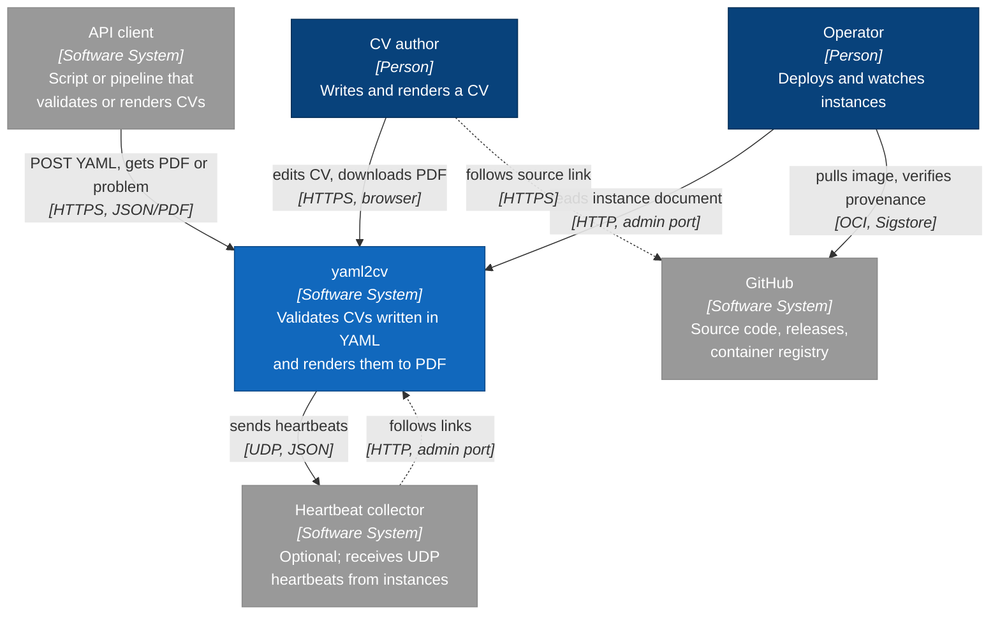

| Partner | Input to yaml2cv | Output from yaml2cv |
| --- | --- | --- |
| CV author | YAML typed into the editor, or a `cv.yaml` imported in the browser; a photo picked in the browser | Validation status, SVG page preview, PDF download, `cv.yaml` download |
| API client | YAML request body (`application/yaml`, `text/yaml`, `text/plain`) | `application/pdf`, `{"valid": true}` or RFC 9457 problem details |
| Operator | Environment variables, admin HTTP requests | Instance document (JSON), logs |
| Heartbeat collector | — | One UDP datagram per interval with name, version, address, status and admin links |
| GitHub | — (nothing is fetched at run time) | The editor footer links to the commit and the repository |

yaml2cv calls nothing on the internet at run time. The only outgoing traffic
is the optional heartbeat.

### 3.2 Technical context

| Channel | Protocol | Notes |
| --- | --- | --- |
| Public listener, `PORT` (8000) | Plain HTTP/1.1 | TLS and per-client rate limiting belong to a reverse proxy in front. |
| Admin listener, `ADMIN_PORT` (9000) | Plain HTTP/1.1 | Bound to `127.0.0.1` by default; never expose it to the internet. |
| Heartbeat, `PHONE_HOME_TARGET` | UDP, one JSON datagram | Fire and forget; send errors are logged. |
| Typst | Child process through an Erlang port | Arguments only, no shell; job directory as working directory. |

---

## 4. Solution strategy

| Goal or constraint | Approach | Details |
| --- | --- | --- |
| Privacy | Stateless service. The CV, including its photo, travels with every request and lives only in memory and in a private per-render job directory that is always deleted. CV content is never logged. | §8.4, ADR 0010, 0028 |
| Security against injection | User content is **data, never markup**: the validated CV is serialised to JSON and the Typst theme reads it with `json("cv.json")`. | §8.3, ADR 0003 |
| Security against resource exhaustion | Limits at every stage: body size, YAML node budget and parse timeout, photo size and pixels, compile timeout with an OS-level kill, a global concurrency limiter. | §8.3, ADR 0009, 0010 |
| Strict validation | A typed domain model (`Cv`) built by a decoder that collects all errors with paths. Unknown keys are errors. | §8.1, ADR 0007 |
| Replaceable renderer | A `Renderer` is a record of functions. Typst implements it; the limiter wraps it; tests fake it. | §5.2, ADR 0003 |
| Simple, robust front end | Server-rendered HTML fragments with htmx; a small vendored script for editor comfort. No SPA, no build step. | ADR 0004, 0011 |
| Responsiveness | One request per typing pause returns status and preview; the photo stays in the browser during previews; SVG pages are sent as text and gzip-compressed. | §6.2, ADR 0039, 0041 |
| Fault tolerance | An OTP supervision tree restarts the limiter and listeners independently. | §5.3 |
| Reproducible output and builds | Bundled fonts only; tools pinned in the Nix flake and the Containerfile; signed build provenance. | §7, ADR 0005, 0013, 0031 |

---

## 5. Building block view

### 5.1 Level 1: containers

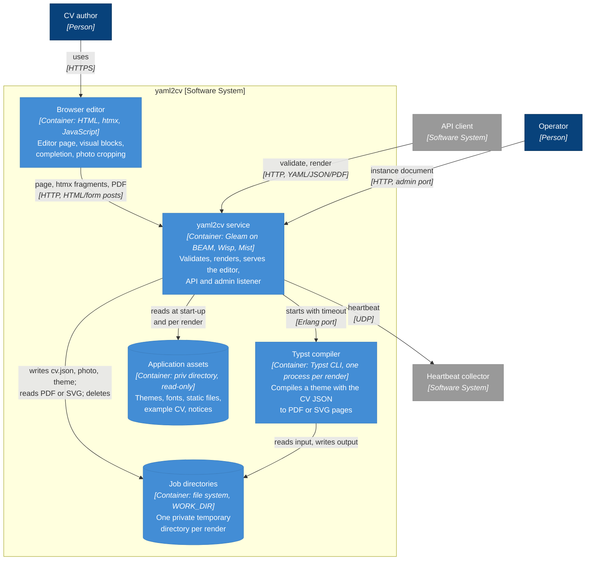

| Container | Responsibility | Source |
| --- | --- | --- |
| Browser editor | Renders the server's HTML; htmx posts the form on input and swaps fragments. `editor.js` adds indentation, line numbers, jump to error, schema completion, the YAML file menu, photo cropping and re-encoding, and the photo placeholder for previews. `theme.js` and `language.js` remember the colour theme and UI language in `localStorage`. | `priv/static/` |
| yaml2cv service | The Gleam application: configuration, HTTP routing, decoding, rendering orchestration, editor pages, admin listener, heartbeat. | `src/` |
| Typst compiler | Turns `cv.typ` plus `cv.json` (and the photo) into `cv.pdf` or `page-NN.svg`. Runs with `--root .`, `--ignore-system-fonts` and only the bundled fonts. | external binary, `TYPST_PATH` |
| Job directories | Hold the inputs and outputs of exactly one render. Mode `0700`, removed whatever the outcome. | `WORK_DIR` |
| Application assets | Typst themes (`themes/<name>/cv.typ`), Inter fonts, CSS/JS/htmx, the example CV, `notices.json` (image builds only). | `priv/` |

### 5.2 Level 2: components of the yaml2cv service

The service has four groups of modules. Arrows point from caller to callee.

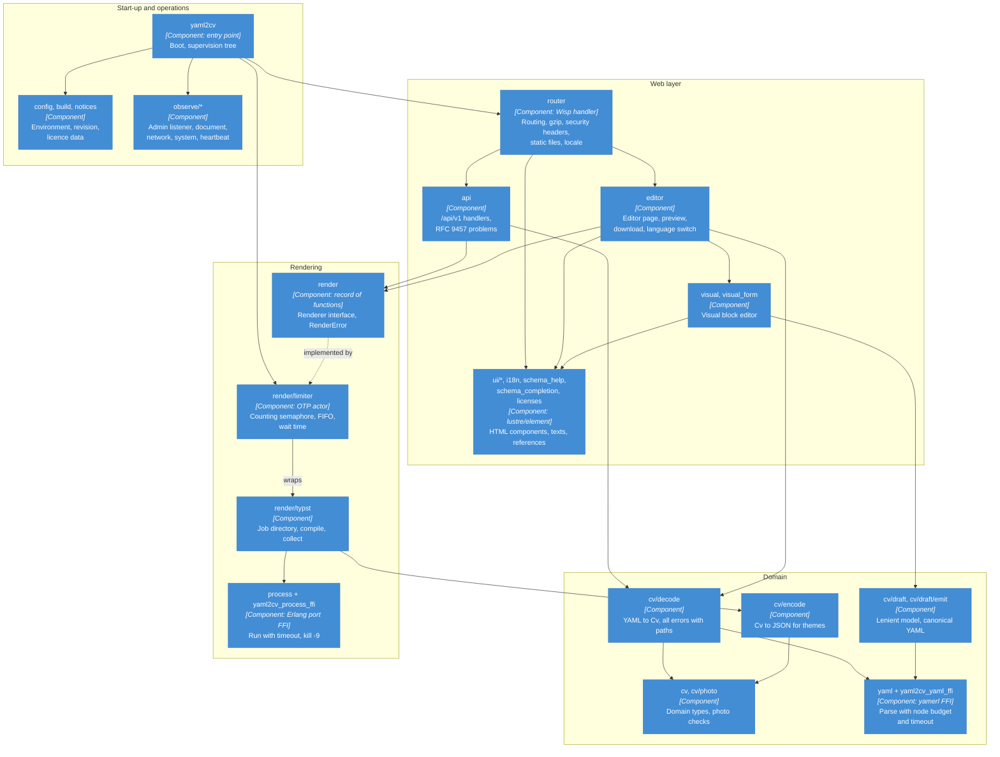

#### Web layer (`src/yaml2cv/web/`)

| Module | Responsibility |
| --- | --- |
| `router` | Single entry for public HTTP requests. Middleware in order: access log, crash rescue, `HEAD`, gzip (`compress`), security headers, static files under `/static`. Dispatches by path; adds `vary` headers for localised responses. Holds a `Context` with every dependency (renderer, limits, build, example CV, notices) so tests can swap them. |
| `api` | `POST /api/v1/validate` and `/render`: checks content type and body size, decodes, renders, maps decode and render errors to problem types. |
| `problem` | Builds RFC 9457 `application/problem+json` responses. |
| `editor` | The editor page (`GET /`), language switch (`POST /`), `POST /editor/preview` (status plus out-of-band preview), `POST /editor/download`. |
| `visual`, `visual_form` | `POST /editor/visual` turns YAML into blocks; `POST /editor/visual/update` turns the posted block form back into YAML (ADR 0024). |
| `ui/*` | One module per UI component, each paired with `priv/static/css/components/<name>.css`; builds markup with `lustre/element` as a pure HTML builder (ADR 0011). |
| `i18n`, `i18n/*` | `Locale` type, locale resolution per request, one `Texts` record per language (ADR 0025). |
| `schema_help`, `schema_completion` | The schema as data: the in-app reference dialog and the completion JSON for the YAML editor are both built from it (ADR 0022, 0045). |
| `licenses` | `/licenses` page and dialog fragment from `notices.json` (ADR 0032). |
| `compress` | Gzip middleware for textual in-memory bodies of at least 1 KiB (ADR 0019). |

#### Domain (`src/yaml2cv/cv*`, `src/yaml2cv/yaml.gleam`)

| Module | Responsibility |
| --- | --- |
| `yaml` + `yaml2cv_yaml_ffi.erl` | Own binding to yamerl (ADR 0008). Returns typed nodes or a typed error; enforces a budget of 20 000 nodes after alias expansion and a 2 s parse timeout. |
| `cv` | The validated domain model: `Cv`, `Style` (theme, colour, paper, photo shape), `Person`, `Contact`, `Section` with `Entries`, `Skills` or `Text` content. Invalid states are not representable. |
| `cv/decode` | Strict decoder from YAML nodes to `Cv`. Collects every `SchemaError(path, problem)`; `SchemaProblem` is structured so the API can word it in English and the UI can translate it. |
| `cv/photo` | Validates a `data:` URI photo: JPEG or PNG, signature, at most 512 KiB, at most 4000 px a side (ADR 0028). |
| `cv/encode` | `Cv` to the JSON the themes read; the photo is replaced by its file name. |
| `cv/draft`, `cv/draft/emit` | Lenient model of a CV where every scalar is a string, and its emitter writing canonical YAML. Backs the visual editor. |

#### Rendering (`src/yaml2cv/render*`, `src/yaml2cv/process.gleam`)

| Module | Responsibility |
| --- | --- |
| `render` | The `Renderer` type, `render_pdf` and `render_svg_pages`, and `RenderError` (`CompileFailed`, `TimedOut`, `Overloaded`, `RendererUnavailable`). |
| `render/limiter` | OTP actor acting as a counting semaphore. Callers queue FIFO and give up after `RENDER_QUEUE_WAIT_MS` with `Overloaded`. Slots are freed on return, crash, or death of the caller (monitored). `limit/3` wraps any renderer. |
| `render/typst` | The Typst backend: creates a private job directory, copies the theme, writes `cv.json` and the photo, runs `typst compile`, reads `cv.pdf` or up to 10 `page-NN.svg`, deletes the directory. |
| `process` + `yaml2cv_process_ffi.erl` | Runs an executable through an Erlang port, collects output, kills the OS process with `kill -9` on timeout. |

#### Start-up and operations

| Module | Responsibility |
| --- | --- |
| `yaml2cv` | `main`: loads configuration, reads the example CV and notices, starts the supervision tree; exits with status 1 on any start-up error. |
| `config` | Parses and validates every environment variable; collects all errors; warns about risky combinations (e.g. heartbeat with a loopback admin listener). |
| `build` | Interprets `GIT_REVISION` as clean, modified (`-dirty`) or unknown for the footer (ADR 0031). |
| `notices` | Reads `priv/notices.json` (shared format with the generator in `dev/notices.gleam`). |
| `observe/admin` | Admin listener routes `/`, `/config`, `/status`, `/healthz`. |
| `observe/document` | The instance document and the heartbeat payload (ADR 0020). |
| `observe/network`, `observe/system` | Reachable interface addresses; memory, CPU load, I/O pressure and disk use from `/proc`, cgroups and `df`. |
| `observe/heartbeat` + `yaml2cv_udp_ffi.erl` | Actor that sends the heartbeat datagram on a timer. |

### 5.3 Supervision tree

`main` starts one `static_supervisor` with the `one_for_one` strategy. A
crashing child is restarted alone; request handlers run in Mist's own
processes, so a crash while handling one request (rescued into a `500` by
`wisp.rescue_crashes`) affects only that request.

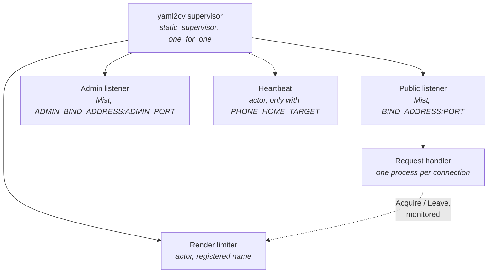

The limiter is registered under a name and reached through
`limiter.named/1`, so the renderer captured in the router's `Context` keeps
working after the limiter restarts.

### 5.4 Themes

A theme is a directory `priv/themes/<name>/` with an entry file `cv.typ`
that loads `json("cv.json")`. Themes import no Typst packages; user content
cannot add imports because it is data. Shipped themes:

| Theme | Character | ADR |
| --- | --- | --- |
| `classic` (default) | Two columns, timespan left, New Computer Modern | 0009 |
| `minimal` | Single column, quiet | 0015 |
| `studio` | Accent sidebar with photo, Inter | 0030 |
| `spotlight` | Accent band with photo on page one, Inter | 0030 |
| `cover` | Cover page with a large photo, Inter | 0030 |

All themes render the name as a level 1 and each section as a level 2
heading, keep one reading order, print link addresses and write PDF metadata
(ADR 0018, 0035, 0036, 0037). Adding a theme means adding a directory and a
`Theme` variant; tests render every theme in `cv.themes`.

---

## 6. Runtime view

### 6.1 Render a CV through the API

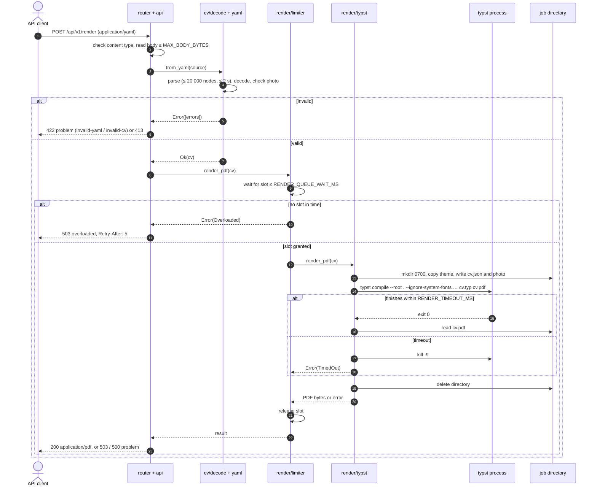

Typst diagnostics are logged and never returned; the client sees only the
problem type (`render-failed`, `render-timeout`, `renderer-unavailable`).

### 6.2 Live validation and preview while typing

One request per pause in typing returns both the validation status and the
preview (ADR 0040, 0041). Large photos stay in the browser (ADR 0039).

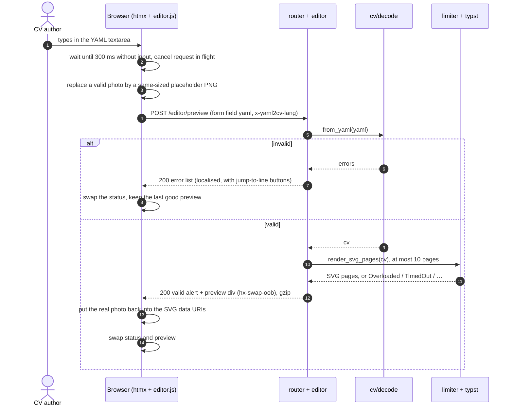

Pages are embedded as ``: the browser treats
them as images, so scripts in them never run and links from the CV stay
inert (ADR 0019).

### 6.3 Visual block editing

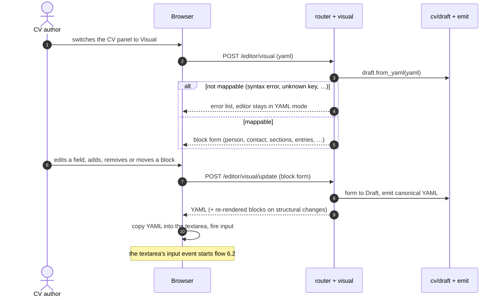

The YAML textarea stays the single source of truth; the visual mode only
writes to it. The first visual edit rewrites the YAML canonically, dropping
comments (ADR 0024).

### 6.4 Start-up

1. `config.load` reads every environment variable and the `priv` directory;
   all errors are collected and logged, then the VM halts with status 1.
2. The example CV and `notices.json` are read; a missing notices file means
   an empty list, an invalid one aborts the start.
3. The supervisor starts the limiter, the public listener, the admin
   listener and, with `PHONE_HOME_TARGET`, the heartbeat.
4. Configuration warnings are logged (e.g. heartbeat links that point to a
   loopback admin listener).

### 6.5 Heartbeat

Every `HEARTBEAT_INTERVAL_MS` the heartbeat actor builds the instance
document (interfaces and system status sampled at that moment), reduces it
to the heartbeat payload and sends one UDP datagram to `PHONE_HOME_TARGET`.
A collector treats an instance as missing after `HEARTBEAT_MIA_MS` of
silence and can follow the absolute admin URLs in the payload. Send errors
are logged and never stop the service (ADR 0020).

---

## 7. Deployment view

### 7.1 Production

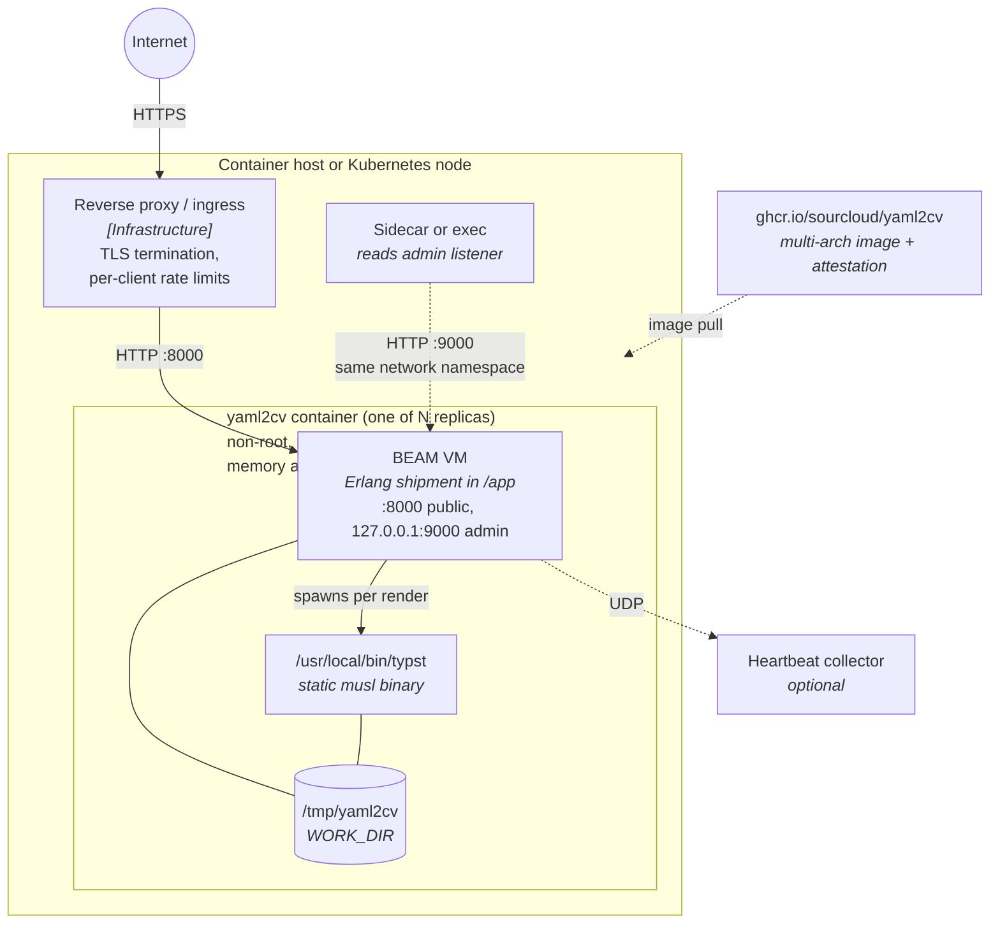

| Element | Notes |
| --- | --- |
| Image | `ghcr.io/sourcloud/yaml2cv:X.Y.Z`, also tagged `X.Y` and `X`; no `latest` (ADR 0033). Base: `erlang:<OTP>-alpine`, pinned by digest. Runs as user `yaml2cv`, `ENTRYPOINT /app/entrypoint.sh run`. |
| Replicas | Any number; nothing is shared between them, so no session affinity is needed. |
| Resources | Rendering is CPU-bound: set `RENDER_CONCURRENCY` to the container's CPUs. Typst's memory is not limited by the application; set a container memory limit. |
| File system | Only `WORK_DIR` (`/tmp/yaml2cv`) is written; works with `--read-only --tmpfs /tmp --cap-drop=ALL`. |
| Probes | `GET /healthz` on the public port for liveness and readiness. |
| Admin listener | Loopback by default; reachable from outside only with `ADMIN_BIND_ADDRESS` and a published port. |
| Licences | `/app/THIRD_PARTY_NOTICES.md`, `/app/licenses/`, and `/licenses` in the UI. |

### 7.2 Image build

The `Containerfile` has three stages, all on the same pinned Erlang/OTP
Alpine image (ADR 0013, 0014):

1. **typst** downloads the official static musl Typst release for the build
   architecture and checks its SHA-256.
2. **build** installs the pinned Gleam release (checksum-verified), runs
   `gleam export erlang-shipment`, then the notices generator
   (`gleam run -m notices`), which writes `THIRD_PARTY_NOTICES.md`,
   `licenses/` and `priv/notices.json` from `manifest.toml`,
   `third_party.toml`, Erlang/OTP and Typst (ADR 0032).
3. **runtime** copies Typst, the shipment and the notices, sets
   `GIT_REVISION` and `BUILD_DATE` from build arguments, and drops to the
   unprivileged user.

Tool versions are pinned twice and must move together: in `flake.nix` /
`flake.lock` for development and CI, and in the `Containerfile` for the
image.

### 7.3 Development and delivery pipeline

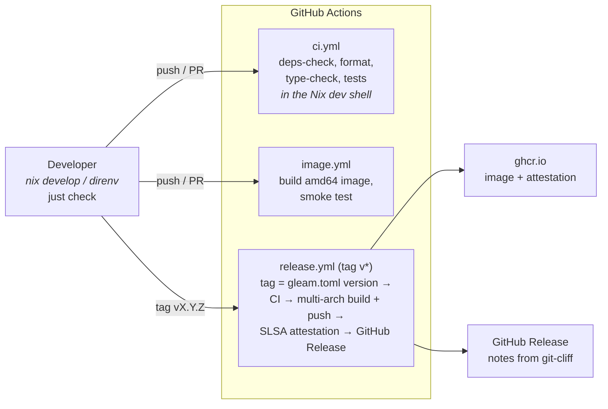

- `ci.yml` runs `just check`: lockfile drift (ADR 0027), `gleam format
  --check`, `gleam check`, `gleam test`. The dev shell includes Typst and
  `pdftotext`/pdfminer, so rendering and text-extraction tests run in CI.
- `image.yml` builds the image and runs `scripts/smoke-test.sh` against it
  (health, render the example CV, admin listener).
- `release.yml` publishes only after the version check and CI pass, attests
  build provenance for the image digest and creates the GitHub Release with
  notes generated from Conventional Commits (ADR 0023, 0026, 0031).
- Dependabot keeps the pinned GitHub Actions current (ADR 0034).

---

## 8. Crosscutting concepts

### 8.1 Domain model and validation

Two models describe a CV:

- **`Cv`** (`cv.gleam`) is the validated model. Required fields are plain
  values, optional ones `Option`, enumerations custom types (`Theme`,
  `Color`, `Paper`, `PhotoShape`), and section content a sum type
  (`Entries`, `Skills`, `Text`). Anything of type `Cv` can be rendered.
- **`Draft`** (`cv/draft.gleam`) is lenient: every scalar is a string, so a
  half-written CV with empty required fields can be shown as blocks. It
  exists only for the visual editor.

`cv/decode` turns YAML nodes into a `Cv` or a list of all errors.
Schema errors carry a path (`sections[1].entries[0].title`) and a
structured `SchemaProblem`; YAML syntax errors carry line and column.
Unknown keys, wrong types, empty text and unknown enum values are errors.
`schema_version: 1` is required, so a future version can add a migration
step. The schema is documented in ADR 0007 and its amendments, and as data
in `web/schema_help`, which a test keeps in step with the decoder's key
lists.

### 8.2 Content as data

User content never becomes Typst markup. `cv/encode` serialises the `Cv` to
JSON; each theme loads `cv.json` and places strings as text. A CV cannot
import packages, read files or run code in Typst. The photo is passed as a
file name chosen by the service (`photo.jpg` or `photo.png`), never a path
from the user. In the editor, previews are `` sources, so SVG content
is inert.

### 8.3 Security

| Threat | Measure |
| --- | --- |
| Markup injection into the renderer | Content as data (§8.2). |
| Reading host files through Typst | `--root` is the job directory; only the service writes into it; themes use no packages; photos must be JPEG or PNG data URIs. |
| Oversized or expanding input | `MAX_BODY_BYTES`; YAML node budget (20 000) and parse timeout (2 s) against alias bombs and deep nesting; photo ≤ 512 KiB and ≤ 4000 px a side. |
| Slow or stuck renders | `RENDER_TIMEOUT_MS`, then `kill -9` of the OS process. |
| Render floods | Global concurrency limiter with a bounded queue wait and `503 Retry-After`. Per-client limits belong to the proxy. |
| Script injection in the editor | CSP `default-src 'self'`, `img-src 'self' data:`, no inline script or style, `frame-ancestors 'none'`, `form-action 'self'`; `x-content-type-options: nosniff`; `referrer-policy: no-referrer`. |
| Information leaks | Typst output and file paths are logged, never returned. The admin listener is loopback-only by default. |
| BREACH via compression | Responses hold no secrets: no cookies, sessions or tokens (ADR 0019). |
| Tampered images | Signed SLSA provenance verified with `gh attestation verify` (ADR 0031). |
| Container escape impact | Non-root user, works with read-only root file system and all capabilities dropped. |

Vulnerability reports go through [SECURITY.md](../SECURITY.md).

### 8.4 Privacy and statelessness

- No database, file store, cache, cookie or session. The UI language and
  colour theme live in the browser's `localStorage` and travel as a header
  or form field (ADR 0012, 0025).
- A CV exists in the service only while its request runs: in memory and, for
  a render, in a job directory with mode `0700` that is deleted in every
  outcome.
- CV content, including photos, is never logged; error messages never
  repeat photo data.
- The editor crops, scales and re-encodes a picked photo in the browser,
  which strips EXIF data such as GPS location (ADR 0028).

### 8.5 Error handling

- Functions return `Result` with descriptive error types; `let assert` is
  used only in tests. Errors are mapped once, at the edge: `api` maps them
  to problem types, `editor` to localised alerts.
- The API speaks RFC 9457 problem details with a stable `type` slug
  (`invalid-yaml`, `invalid-cv`, `unsupported-media-type`,
  `content-too-large`, `overloaded`, `render-timeout`,
  `renderer-unavailable`, `render-failed`). Wording may change; slugs and
  paths are stable (ADR 0010, 0033).
- Unexpected crashes in a handler are rescued into a `500` and logged;
  supervised processes are restarted.
- Invalid configuration aborts start-up with every problem listed.

### 8.6 Configuration

All settings are environment variables, parsed and validated at start-up
into a typed `Config` (ADR 0010). There is no configuration file. The README
lists every variable; their names and meaning are part of the stable
contract (ADR 0033).

### 8.7 User interface

- Pages and fragments are rendered on the server with `lustre/element` as a
  type-safe HTML builder. htmx (vendored, 2.0.4) posts the editor form and
  swaps fragments, including out-of-band swaps.
- A small component library: each component is one Gleam module in
  `web/ui/` and one CSS file in `priv/static/css/components/`, classes
  `ui-<name>` with BEM modifiers. `app.css` orders the cascade with
  `@layer tokens, base, components, layout`. Light and dark colour schemes
  come from tokens and a theme switch (ADR 0011, 0012).
- `editor.js` adds what HTML cannot: tab indentation, line-number gutter,
  jump to error, the YAML file menu, schema completion, photo processing
  and the preview placeholder. Download and the language switch are plain
  form posts and also work without JavaScript.
- Accessibility: keyboard paths for every control, no keyboard traps in the
  textarea, ARIA attributes for the completion list and menus.

### 8.8 Internationalisation

The UI speaks English and German. The locale is resolved per request: `lang`
field, then the `x-yaml2cv-lang` header (set by `hx-headers` on `<body>`),
then `Accept-Language`, then English. All texts live in one `Texts` record
per locale, so a missing translation is a compile error. Decoder errors are
structured and translated in the UI; the API and YAML syntax messages stay
English (ADR 0025). A CV's own `language` key sets the language of the PDF,
independently of the UI (ADR 0036).

### 8.9 Observability

- **Logs**: Wisp's access log and Erlang `logger` for start-up, render
  failures, timeouts and overload. No CV content.
- **Admin listener**: a JSON document with name, version, dependencies
  (`REQUIRES`), reachable addresses, heartbeat timing, build and deployment
  metadata, effective settings and host or cgroup load (ADR 0020).
- **Heartbeat**: optional UDP announcement to a collector.
- **Build identity**: version and revision in the page footer, in the admin
  document and in PDF metadata (ADR 0018, 0031).

### 8.10 Testing

- Test-driven: a failing test first, tests in `test/` mirroring `src/`.
- Pure functions with injected side effects. The router takes a `Context`,
  so handler tests use a fake `Renderer`; the limiter is tested with fake
  renderers and real processes.
- `render/typst` tests run the real Typst binary from the dev shell for
  every theme, including text extraction with `pdftotext` and pdfminer to
  check headings, link addresses and reading order (ADR 0035, 0037).
- Snapshot tests with `birdie` for larger outputs (JSON, canonical YAML,
  schema reference); new snapshots are reviewed before they are accepted.
- A round-trip test over the example CV catches drift between decoder,
  draft and emitter.
- The smoke test runs against the built image in CI.
- `editor.js` has no automated tests; it is checked in a browser. The README
  demo is recorded with Playwright (ADR 0044, 0046), which exercises the
  main editor paths.

### 8.11 Third-party components and licences

Gleam and Erlang dependencies are locked in `manifest.toml` (CI fails on
drift, ADR 0027). Assets committed to the repository (Inter fonts, htmx,
Typst's embedded font notices) are listed in `third_party.toml`. The notices
generator combines both with Erlang/OTP and Typst at image build time; a
dependency without licence text fails the build (ADR 0013, 0032).

---

## 9. Architecture decisions

All decisions are recorded in [`docs/adr/`](adr/README.md). The most
important ones by topic:

| Topic | ADRs |
| --- | --- |
| Platform and tooling | [0002](adr/0002-use-gleam-on-the-erlang-target.md) Gleam on BEAM · [0005](adr/0005-nix-flake-dev-environment.md) Nix flake · [0008](adr/0008-own-yaml-bindings-over-yamerl.md) own YAML bindings · [0014](adr/0014-upgrade-to-erlang-otp-29.md) OTP 29 |
| Rendering | [0003](adr/0003-pluggable-renderer-with-typst-backend.md) pluggable renderer · [0009](adr/0009-typst-renderer-execution-and-themes.md) execution, limits, themes · [0015](adr/0015-minimal-theme.md), [0030](adr/0030-photo-centred-creative-themes.md) themes · [0035](adr/0035-machine-readable-pdf-text.md), [0037](adr/0037-single-reading-order-in-every-theme.md) machine-readable PDFs |
| CV schema | [0007](adr/0007-cv-schema-version-1.md) schema v1 · [0028](adr/0028-profile-photo.md) photo · [0036](adr/0036-cv-language-and-candidate-metadata.md) language and metadata |
| HTTP API and operation | [0010](adr/0010-http-api.md) API, configuration, limits · [0019](adr/0019-svg-preview-and-gzip.md) gzip · [0020](adr/0020-phone-home-observability.md) admin and heartbeat · [0033](adr/0033-stability-promise-for-1-0.md) stability promise |
| Editor | [0004](adr/0004-server-rendered-web-app-with-wisp-and-htmx.md) Wisp and htmx · [0011](adr/0011-browser-editor.md) editor and components · [0024](adr/0024-visual-block-editor.md) visual editor · [0025](adr/0025-ui-localisation.md) localisation · [0039](adr/0039-lean-preview-requests.md), [0041](adr/0041-one-request-for-status-and-preview.md) lean previews · [0045](adr/0045-schema-completion-in-the-yaml-editor.md) completion |
| Build, release, supply chain | [0013](adr/0013-container-image-and-release.md) image and releases · [0023](adr/0023-release-notes-from-conventional-commits.md) release notes · [0027](adr/0027-lockfile-drift-check.md) lockfile check · [0031](adr/0031-build-provenance-and-source-link.md) provenance · [0032](adr/0032-complete-notices-and-licenses-page.md) notices |
| Documentation | [0001](adr/0001-record-architecture-decisions.md) ADRs · [0047](adr/0047-architecture-documentation-with-arc42-and-c4.md) this document |

---

## 10. Quality requirements

### 10.1 Quality tree

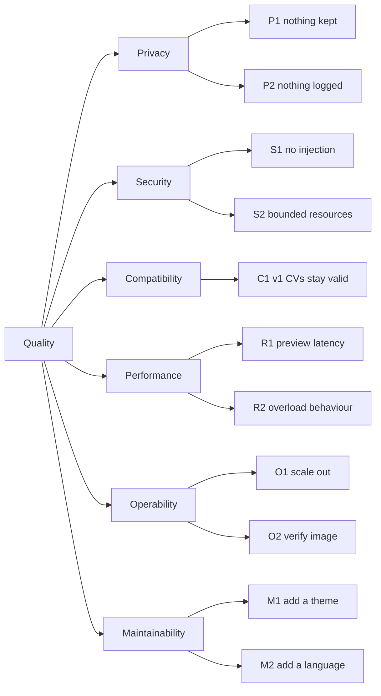

### 10.2 Quality scenarios

| ID | Scenario | Expected response |
| --- | --- | --- |
| P1 | A CV with a photo is rendered; afterwards the container's file system and memory are inspected. | No trace of the CV or photo remains outside of the request; the job directory is gone even after a failed or timed-out compile. |
| P2 | Any request fails validation or rendering. | Logs contain the request line and error class, never CV content or photo data. |
| S1 | A CV contains Typst syntax, `#import`, or a `javascript:` URL in a link. | It is printed as text; nothing is evaluated; the preview link is not clickable. |
| S2 | A 1 KB YAML document expands through aliases to millions of nodes, or a CV makes Typst loop. | Parsing stops at 20 000 nodes (413) or after 2 s; the compile is killed after `RENDER_TIMEOUT_MS` (503 `render-timeout`). Other requests continue. |
| C1 | A CV valid under release 1.0.0 is sent to any later 1.x release. | It is still valid and renders (its look may change). |
| R1 | An author types in the editor with the example CV and a photo on a local server. | Status and preview arrive within about 300 ms plus render time (about 20–50 ms) after typing stops; each request uploads about 2 KB. |
| R2 | More renders arrive than `RENDER_CONCURRENCY` slots. | Requests queue FIFO up to `RENDER_QUEUE_WAIT_MS`, then get `503 overloaded` with `Retry-After`; the editor keeps the last good preview and explains the delay. |
| O1 | Traffic grows. | Add replicas behind the load balancer; no shared state or affinity needed. |
| O2 | An operator wants to know which commit an image came from. | `gh attestation verify` on the image digest names the commit and the release workflow. |
| M1 | A developer adds a theme. | One directory under `priv/themes/`, one `Theme` variant; existing tests render it and check its extracted text. |
| M2 | A developer adds a UI language. | One `Locale` constructor and one `Texts` constant; the compiler lists every missing text. |

---

## 11. Risks and technical debt

| Risk or debt | Impact | Mitigation or next step |
| --- | --- | --- |
| Typst's memory use is not bounded by the application. | A pathological CV can push a container towards its memory limit. | Container memory limit (README); compile timeout. |
| The concurrency limiter is global, not per client. | One client can occupy all render slots. | Per-client rate limits at the proxy (README). |
| `editor.js` (≈ 1 000 lines) has no automated tests. | Regressions in completion, menus or the photo placeholder show up only in the browser. | Placeholder logic falls back to sending the real photo; the demo recording exercises main paths. Browser tests would need a new ADR. |
| The photo checks exist twice, in Gleam and in `editor.js`. | They can disagree. | Disagreement only makes previews slower, never wrong (ADR 0039). |
| Decoder, draft model and emitter must all follow every schema change. | The visual editor could drop or mangle new keys. | Round-trip test over the example CV; schema reference test against the decoder's key lists. |
| Tool versions are pinned in two places (Nix flake, Containerfile). | Dev shell and image can diverge. | Upgrade both together (ADR 0013, `AGENTS.md`); a test ties `typst-assets` to the Typst version. |
| Killing a timed-out Typst relies on Unix `kill -9` and the port's OS pid. | Not portable to Windows. | Linux containers are the only supported target. |
| `studio`'s sidebar holds a fixed amount of content. | Very long contact or skill lists overflow page one. | Documented in ADR 0030; a layout change would be a theme change. |
| Single maintainer. | Bus factor of one. | ADRs, this document and `AGENTS.md` keep the knowledge in the repository. |
| This document can drift from the code. | Misleading onboarding. | Update it with every structural change (ADR 0047, `AGENTS.md`). |

---

## 12. Glossary

| Term | Meaning |
| --- | --- |
| ADR | Architecture decision record, one file per decision in `docs/adr/`. |
| Admin listener | Second HTTP listener (default `127.0.0.1:9000`) describing the instance. |
| BEAM | The Erlang virtual machine that runs the compiled Gleam code. |
| Canonical YAML | YAML written by the emitter: keys in schema order, empty optional keys left out, no comments. |
| CV | Curriculum vitae; here, a YAML document following schema version 1. |
| `Cv` | The validated domain type a CV decodes into. |
| Draft | The lenient model behind the visual editor; every scalar is a string. |
| Heartbeat | Periodic UDP datagram announcing an instance to a collector. |
| htmx | Small JavaScript library that issues requests from HTML attributes and swaps the returned HTML. |
| Job directory | Private temporary directory holding the input and output of one render. |
| Limiter | Actor that caps the number of renders running at the same time. |
| Mist | Gleam HTTP server. |
| OOB swap | htmx out-of-band swap: one response updates several page regions. |
| Problem details | RFC 9457 JSON error format (`application/problem+json`). |
| Renderer | Record of functions turning a `Cv` into PDF bytes or SVG pages. |
| Schema version 1 | The CV format covered by the stability promise (ADR 0007, 0033). |
| Shipment | `gleam export erlang-shipment` output: compiled BEAM files, `priv` and a start script. |
| Theme | Typst template directory under `priv/themes/` that lays out `cv.json`. |
| Typst | Typesetting system used as the rendering backend. |
| Visual mode | Editor mode that shows the CV as form blocks instead of YAML. |
| Wisp | Gleam web framework for request handling and middleware. |
